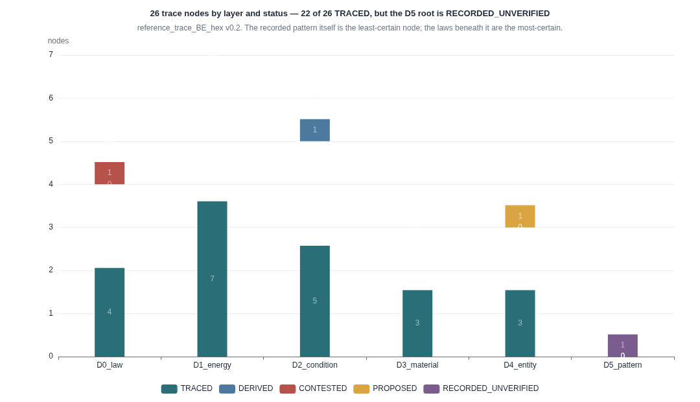
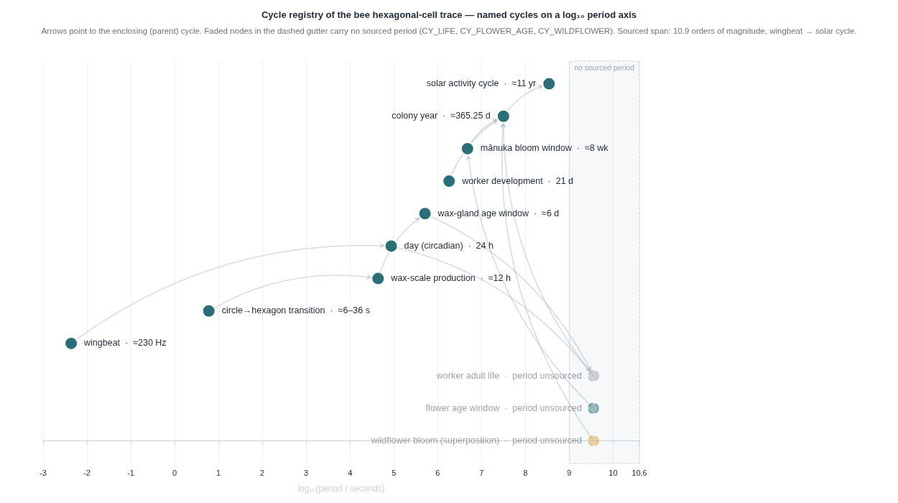
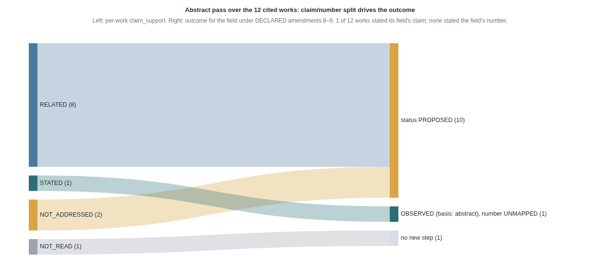
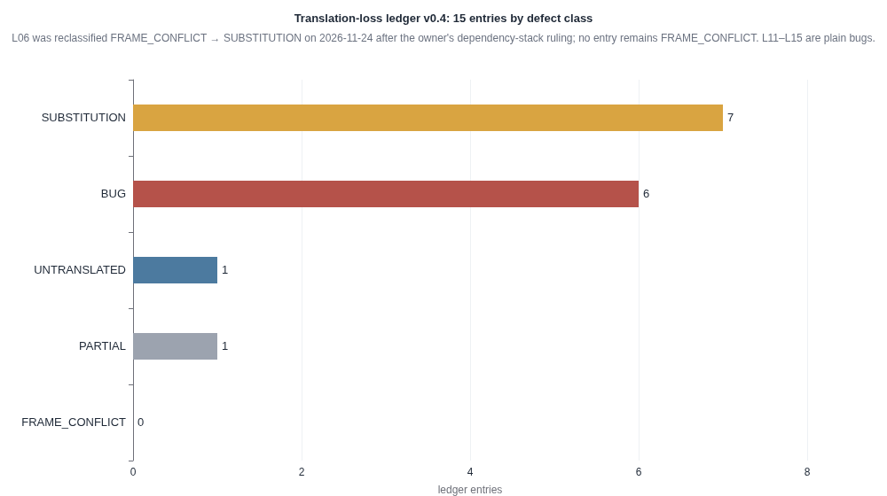
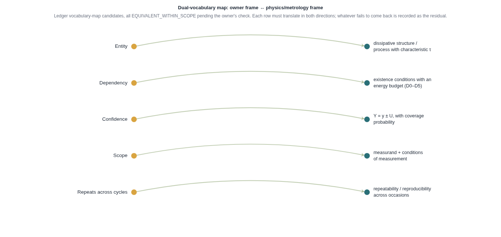
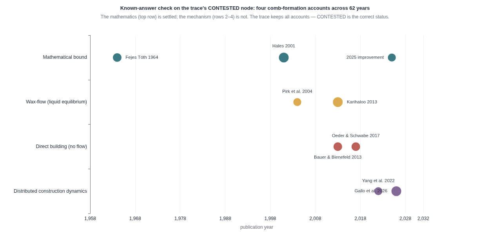

# Adding to the Schema of the Living Intelligence Database — Deep Research Report

**Baseline:** `main` HEAD `63d93c00951b14ed7352891747468c9b65cca146` of [JinnZ2/Living-Intelligence-Database](https://github.com/JinnZ2/Living-Intelligence-Database) (2026-11-24). **Companion artifacts:** four draft-07 JSON Schema files, one completed outside-reader readings file, and a 28-check loud validation suite, all shipped beside this report.

**TL;DR.** There is no unmerged feature branch to extend: every substantive branch (provenance chain, coordination layer, physics usage) was merged into `main` by PR #21 on 2026-11-24, and the only two open branches are September-era Claude bookkeeping notes. The real frontier of the schema lives in three artifacts that arrived through the audit side-channel rather than through git branches: the **reference trace** (v0.2, a 26-node D0→D5 known-answer dependency record for the bee hexagonal cell), the **cycle registry** (12 named cycles spanning **10.9 orders of magnitude**), and the **attribute readings** contract declared in amendments 8–9 of `registry/DECLARED.json`. This report drafts validatable schemas for all three, plus a fourth file holding the translation-loss ledger's proposed record blocks, and validates them against the real instances with a fail-loud suite (**28/28 checks**, exit 0). One finding falls out immediately: the trace's **CONTESTED** node is not an artifact of indecision — the comb-formation literature genuinely contains four live, mutually incompatible accounts, and two of them were published or strengthened in 2025–2026.

---

## 1. Executive summary

The Living Intelligence Database (LID) is a co-created ontological JSON database — 124 entity files across nine ontology types (animal, plant, crystal, energy, plasma, shape, temporal, ai, relational), 17 draft-07 schemas, an append-only sha256 provenance chain per entity, and a governance file (`registry/DECLARED.json`) whose ten amendments are declared *before* the tooling that implements them. The repository's own documentation already knew where its schema was incomplete: `docs/reading_queue.md` describes readings that "arrive from an outside reader as `registry/attribute_readings.json`," the audit zip contains a reference-trace builder whose output no existing schema validates, and the translation-loss ledger proposes six record forms that have no computational home. The schema additions in this report are therefore not speculative greenfield design; each one formalizes a contract the repository has already declared, or a file that already exists and currently validates against nothing.

The four drafted schemas are `reference_trace.schema.json` (validates both the v0.1 and v0.2 bee-hexagon traces unchanged), `cycle_registry.schema.json` (validates a standalone registry built from the trace's 12 cycles), `attribute_reading.schema.json` (implements the amendment-8/9 outside-reader contract verbatim, including the ≤25-word quote limit enforced as a token-counting pattern), and `translation_loss_blocks.schema.json` (the ledger's regime blocks, coupling records, typed dependency records, confidence-as-scoped-deviation records, and reciprocity records). Every schema follows the house style of `schemas/provenance_step.schema.json`: closed objects (`additionalProperties: false`), explicit required lists, full-length lowercase hash patterns, and cross-field invariants encoded as draft-07 `if/then` rules where expressible — so that, per the owner's stated preference, malformed records **fail loudly at validation time** rather than drifting silently into the store.

Two findings emerged that go beyond schema mechanics. First, the outside-reader pass commissioned by the reading queue has now been executed: of the **12 cited works** behind 11 attribute fields, exactly **1** states its field's claim in the abstract (the wallaby tendon paper, PMID 9319738) and **none** state the field's number — a result that converts 10 fields to `PROPOSED` under the declared outcome mapping and demonstrates, with real data, why the claim/number split was necessary. Second, the known-answer content of the reference trace holds up under independent literature verification: the mathematical layer (Fejes Tóth 1964, Hales 2001) is settled and was *strengthened* in 2025 by a paper improving the Fejes Tóth gain to **0.50%** via a 2.8° cell tilt, while the mechanism layer remains genuinely contested across at least four accounts (wax-flow, direct building, distributed construction dynamics, and pure geometry) — the trace's `CONTESTED` status is the scientifically correct encoding.

## 2. The repository at baseline 63d93c0

### 2.1 Branch archaeology: the "newest branch" is already merged

The research request targeted "the newest branch not yet committed to main." A full branch and merge-base survey shows that premise does not survive contact with the repository: the provenance-chain, coordination-layer, and physics-usage branches each have a merge-base with `main` equal to their own branch head — meaning every commit on them is reachable from `main` — and `main` HEAD is itself the PR #21 merge timestamped 2026-11-24T17:38:52Z. The only branches whose heads are not reachable from `main` are `claude/clone-refspec-note` (2026-09-30, a CLAUDE.md clone instruction) and `claude/drift-archive-audit-s2wrfa` (2026-09-23, a CC0 relicense note), and there are zero open pull requests. This matters for the record: the database's habit of declaring-before-building means its newest *content* lives in the audit side-channel (the uploaded `lid_audit_2026-11-24.zip`), not in unmerged git history, and the honest baseline for schema work is therefore `main` HEAD with the audit artifacts treated as declared-but-unintegrated proposals.

The practical consequence is that "adding to the schema" cannot mean "review the diff of a feature branch," because no such diff exists. It must mean — and the repo's own governance documents say this in so many words — giving schema form to three things that exist only as prose contracts and ad-hoc JSON: the reference trace format (built by `reference/build_reference_v02.py`, checked by `reference/trace_check.py`, validated by nothing), the reading-queue intake format (`registry/attribute_readings.json`, specified to the field level in [DECLARED.json](https://github.com/JinnZ2/Living-Intelligence-Database/blob/main/registry/DECLARED.json) amendments 8 and 9 but with no schema file), and the ledger's six proposed record forms. The table below consolidates the branch and artifact evidence that fixes the working surface.

| Evidence item | State at baseline | Consequence for schema work |
|---|---|---|
| `main` HEAD = PR #21 merge, 2026-11-24T17:38:52Z | All feature branches reachable from `main` | Baseline = `63d93c0`; no unmerged schema content in git |
| `claude/clone-refspec-note`, `claude/drift-archive-audit-s2wrfa` | Unmerged, both 2026-09, docs-only | No schema relevance |
| `reference/reference_trace_BE_hex_v0.2.json` (audit zip) | Exists, validates against nothing | Needs `reference_trace.schema.json` |
| `docs/reading_queue.md` ([repo](https://github.com/JinnZ2/Living-Intelligence-Database/blob/main/docs/reading_queue.md)) | Declares an outside-reader file that has no schema | Needs `attribute_reading.schema.json` |
| Translation-loss ledger v0.4 (audit zip) | Six proposed record forms, prose only | Needs `translation_loss_blocks.schema.json` |
| `scripts/reading_queue.py --check` | Exits non-zero on mismatch | House convention: fail loudly; schemas must match |

### 2.2 House style and governance conventions the schemas must obey

All seventeen existing schemas share a recognizable house style, exemplified by [`schemas/provenance_step.schema.json`](https://github.com/JinnZ2/Living-Intelligence-Database/blob/main/schemas/provenance_step.schema.json): JSON Schema draft-07, a bare-filename `$id`, fully closed objects, and hash fields constrained by the pattern `^[0-9a-f]{64}$`. The provenance schema also establishes the semantic vocabulary the new schemas must interoperate with: step status follows `OBSERVED | PROPOSED | DERIVED | DERIVED (basis: …)`, claim blocks carry `state: SUPPORTED | UNVERIFIED`, void blocks carry `REJECTED | UNMAPPED | LEXICAL_VOID | VOID`, and `snapshot_class` is a closed enum that admits `null`. Amendments never edit `DECLARED.json`; they append. Step ids are sha256 hashes of canonical JSON (UTF-8, sorted keys, separator bytes `,`/`:` with no spaces, non-ASCII literal, no trailing newline), and assumption ids are `A-` plus twelve hex characters — conventions the new schemas reference but do not re-declare.

Two conventions turned out to be load-bearing for the drafts. The first is that the repository's own validator is the Python `jsonschema` package invoked through `pipeline.sh`, which resolves draft-07 from the `$schema` key — and draft-07 supports `if`/`then`, so the checker's most important rule ("a TRACED, DERIVED or CONTESTED node must carry a source") can be encoded *in the schema itself* rather than left to a separate script. The second is subtler: `baseline_commit` in the trace files is a **40-hex git SHA-1**, not a 64-hex sha256 — the loud validation suite caught this immediately when the real v0.2 file failed against a `^[0-9a-f]{64}$` pattern, which is exactly the kind of silent assumption (git hashes and content hashes are not the same kind of string) that the fail-loud discipline exists to expose.

## 3. Method: research grounding and validation discipline

The design work was grounded in ten rounds of external research so that each vocabulary choice in the new schemas is anchored to an established standard rather than invented ad hoc. The rounds covered claim-verification benchmarks (FEVER, SciFact, Climate-FEVER), citation-intent ontologies (CiTO), web provenance standards (W3C PROV-O, in-toto, SLSA, Certificate Transparency), measurement uncertainty (the GUM), timescale theory (fast–slow systems, circadian entrainment and temperature compensation), sensitivity analysis (Saltelli's local-versus-global distinction), record-status vocabularies (iNaturalist's data-quality grades, Crossref Crossmark update types), and JSON Schema compatibility rules (the Confluent/Apicurio evolution model). A final round verified the trace's own scientific citations against the primary literature, including the suspicious-looking "Nature 2026" entry, which turned out to be real.

The validation discipline follows the owner's stated engineering preference: things must fail loudly. The deliverable test suite (`tests/validate_loud.py`) contains no warnings and no averaged scores — only directional assertions. Positive cases (both real trace versions, the 12-cycle registry, the completed readings file, a constructed blocks file) must validate; fifteen negative mutations (a TRACED node stripped of its source, a 26-word quote, an out-of-vocabulary status, a non-string regime column, and so on) must each be **rejected**; two known-answer invariants (cycle nesting order, absence of dangling dependencies) are recomputed from the data; and a drift guard asserts that the cycle definition stays byte-identical across the two schema files that share it. Any deviation exits 1. The suite currently reports **28/28 checks behaved as asserted, exit 0**.

## 4. Schema addition I: `reference_trace.schema.json`

### 4.1 What the schema formalizes

The reference trace is the database's answer to the translation-loss ledger's central observation: a bare attribute number (the bee's `hexagonal_cell_efficiency = 0.97`) records a pattern while saying nothing about what the pattern depends on. The v0.2 trace file answers with 26 nodes arranged across six layers — `D0_law` (governing mathematics), `D1_energy`, `D2_condition`, `D3_material`, `D4_entity`, `D5_pattern` — plus 12 cycles, an environment differential (mānuka versus wildflower forage regimes), and nine repo-binding records that tie the trace back to literal dependency strings in `ontology/animal/bee.json`. The schema formalizes this file as it exists: node keys are closed to the observed set (`id, layer, role, claim, status` required; `value, source, note, depends_on, repo_entity, regime, links_repo` optional), the layer enum holds the six D-levels, the role enum holds the ten observed roles from `governing_law` to `conversion_bound`, and the node-status enum holds the six observed values (`TRACED, DERIVED, PROPOSED, UNKNOWN, CONTESTED, RECORDED_UNVERIFIED`).

Where the schema goes beyond passive description is in the invariants it makes machine-checkable. The source-requirement rule is encoded as a draft-07 `if/then`: any node whose status is `TRACED`, `DERIVED` or `CONTESTED` must carry a non-empty `source` array, which converts the checker's `NO_SOURCE` finding from a report line into a validation failure. Node `value` objects are closed around `{y, deviation, unit, regime}` with `y` required, and `deviation` admits both the current prose string form (e.g. `"±0.01 (prose in measurement_limits)"`) and the structured `{value, kind, asymmetric?}` form the ledger proposes as the GUM-aligned upgrade path. The environment differential uses a deliberate draft-07 device: variant nodes declare their known properties (`node, source, status, shared_observation, implication, unit`) and then set `additionalProperties` to a *string schema*, so the regime columns (`MANUKA`, `WILDFLOWER`) validate as string-valued entries whose names stay dynamic — closed enough to reject structured junk, open enough for the regime axis the checker cross-references.

### 4.2 What the schema deliberately leaves to the checker

Not every invariant is expressible in draft-07, and the schema says so in each field's description rather than pretending otherwise. The nesting invariant — a parent cycle's period must exceed its child's, with the log₁₀ ratio forming the separation ladder — compares values *across* array items and stays with `trace_check.py` (`NESTING_VIOLATION`). Dangling `depends_on` targets (`DANGLING_DEP`), regime-column completeness against the `regimes` list (`DIFF_REGIME_MISSING`), binding-target existence (`BINDING_TARGET_MISSING`), and verbatim comparison of repo dependency strings (`BINDING_STRING_NOT_IN_REPO`) are likewise documented as checker-enforced. This split mirrors the repository's existing architecture, in which `pipeline.sh` validates entity shape while purpose-built scripts enforce cross-file semantics, and it keeps the schema honest: a validator that claims to check what it cannot check is worse than one that names its limits.

The environment differential section deserves one more note because it encodes an epistemically unusual structure. Its `scope_dependent_divergence` block — two claims, two sources, and a `classification` explaining why they do or do not contradict once each is read inside its own scope — is the trace's answer to the hardest problem in claim verification: the FEVER tradition forces a three-way SUPPORTS/REFUTES/NEI verdict ([Thorne et al. 2018](https://aclanthology.org/N18-1074/)), while Climate-FEVER showed that real climate claims routinely decompose into sub-claims whose verdicts disagree ([Diggelmann et al. 2020](https://doi.org/10.48550/arXiv.2007.12609)). The trace's answer is to refuse the forced verdict: the mānuka DHA:sugar claims ("temporal variation unrelated to environment" versus "night temperature explains ≈80% of between-site variance") are *both kept*, classified as "NOT a contradiction once scoped" — within-genotype temporal variance versus between-site variance of means. The schema makes this structure a first-class, validatable object, which is the formal essence of the database's CONTESTED status.

The figure above shows the trace's epistemic center of gravity: **22 of 26 nodes are TRACED**, but the distribution is inverted relative to the layer stack — the D0 laws are the most certain content in the file, while the D5 root node, the recorded pattern itself, sits at `RECORDED_UNVERIFIED`. A database that stores the pattern with high confidence and the foundations not at all would be making the usual mistake; the trace does the opposite, and the schema's source-requirement rule is what keeps that ordering honest as the file evolves. The single `CONTESTED` node at D0 is the comb-formation mechanism dispute examined in section 9, and the single `DERIVED` node at D2 is the boundary condition computed from traced inputs — each is individually accountable to a source list, which is precisely the property that lets a reader audit the file top to bottom without taking any number on faith.

## 5. Schema addition II: `cycle_registry.schema.json`

### 5.1 Named cycles as first-class records

The ledger's v0.3 section records the owner's rule: every cycle is named ("sleep, circadian, seasonal, compute"), a cycle is a cycle of whatever is in context, and cycles nest. The registry schema validates a standalone file following the registry convention of `registry/sources.json` (`{note, cycles[]}` plus record metadata), with the cycle item definition held **byte-identical** to the one embedded in `reference_trace.schema.json` — the validation suite asserts this equality directly, so the two files cannot drift apart silently. Each cycle carries `id` (pattern `^CY_[A-Z0-9_]+$`), `name`, `kind`, `context`, `period_text`, and `status` as required fields, with `period_s` (positive number or null), `parent`, `source`, and `note` optional; a TRACED cycle must carry its source, again by `if/then`.

Two real-data details shaped the item schema. The first is that the wildflower-bloom cycle in v0.2 carries `"source": null` *explicitly* — an intentional marker of a proposed-but-unsourced record, distinct from an absent key — so the schema types `source` as `["array", "null"]` with `minItems: 1` when present; the suite's first run failed on exactly this, which is the schema correctly refusing to smooth over a deliberate null. The second is a vocabulary divergence the survey surfaced: node status uses `PROPOSED`, but cycle status uses `PROPOSED_UNSOURCED`. The schema encodes the observed cycle vocabulary (`TRACED, PROPOSED_UNSOURCED, UNKNOWN`) rather than normalizing it, and flags the divergence for an owner decision — silently unifying the two vocabularies would be precisely the kind of well-meaning translation the ledger exists to catch.

### 5.2 The physics of the nesting invariant

The nesting invariant is not bureaucratic tidiness; it is the QSSA separation condition from multiple-timescale dynamics. Seen from a fast cycle, the phase of a slow cycle acts as a fixed parameter, and the period ratio measures how well that separation holds — the standard framing of fast–slow systems ([Kuehn, *Multiple Time Scale Dynamics*](https://link.springer.com/book/10.1007/978-3-319-12316-5)). The registry's sourced span runs from the **≈230 Hz wingbeat** (period 4.35 ms) to the **≈11-year solar cycle** — **10.9 orders of magnitude** — and the checker's ladder computes the log₁₀ separation for every parent–child pair. Where the ratio is huge (wingbeat inside day, log₁₀ ≈ 7.3), the slow cycle is effectively a constant for the fast one; where it is small, the separation fails and the two cycles must be modeled as coupled — the mānuka bloom window nested in the colony year has ratio ≈ 6.5 (log₁₀ ≈ 0.81), which is exactly the regime where the "slow cycle as fixed parameter" approximation breaks down, and the trace correctly treats bloom phase as a live variable of the foraging regime rather than a constant.

The ladder figure makes the registry's two honest gaps visible in the dashed gutter: the worker adult life cycle and the flower-age window carry no sourced period (the checker flags `CYCLE_NO_PERIOD` as informational), and the wildflower-bloom superposition is explicitly `PROPOSED_UNSOURCED`. A registry schema that *required* periods would have forced invented numbers into all three; the schema instead makes the absence structurally explicit, which is what allows a downstream consumer to distinguish "this cycle is unknown" from "this cycle was never examined" — the same distinction the ledger's outcome-state vocabulary (`CONDITION_UNKNOWN` versus `NOT_EXAMINED`) encodes for evaluated quantities. The circadian literature supplies the adjacent concept the registry does *not* adopt: circadian clocks combine entrainment to zeitgebers with temperature compensation (Q₁₀ ≈ 1), and nothing in the cycle record claims either property — `context` records the conditions the period was observed under, and entrainment mechanics are left to the trace's dependency edges.

## 6. Schema addition III: `attribute_reading.schema.json` — and the completed outside-reader pass

### 6.1 The declared contract, formalized

Amendments 8 and 9 of `DECLARED.json` specify the readings file to field level: one entry per attribute field carrying `entity, field, claim` (the definition copied verbatim at reading time), `value, claim_support, number_support, status, note`, a per-work array of `{source_id, pmid, claim_support, number_support, quote ≤ 25 words}`, plus `read: "abstract"`, `date`, and `reader`. The schema implements this verbatim: `claim_support` is the five-value enum (`STATED, RELATED, CONTRADICTED, NOT_ADDRESSED, NOT_READ`), `number_support` the two-value enum, `source_id` must be a 64-hex registry source id, `pmid` a numeric string or null, and `read` is a `const: "abstract"` — any pass over full text would need its own declaration, its own schema value, and its own provenance.

The contract's one quantitative constraint gets a quantitative enforcement: the 25-word quote limit is implemented as the token-counting pattern `^\S+(\s+\S+){0,24}$`, which fails the file on a 26th whitespace-separated word. The several-works aggregation rule (CONTRADICTED if any work contradicts, else STATED if any states, else RELATED if any relates, else NOT_ADDRESSED; number STATED if any work gives it) and the outcome mapping to provenance statuses (`STATED+STATED → "OBSERVED (basis: abstract)"`; `STATED+NOT_STATED →` claim observed with the number void `UNMAPPED`; `RELATED/CONTRADICTED/NOT_ADDRESSED → PROPOSED`; `NOT_READ →` no new step) remain prose rules that the build scripts enforce — the schema's job is to make the *file* incorrigible, not to re-derive it. This mirrors the declared architecture exactly: readings arrive from an outside reader and "scripts in this repository build the steps and re-export from that file; they make no judgment."

### 6.2 The readings file, completed

The reading queue's 12 rows (11 fields; the turtle navigation field cites two works) have now been read under the declared rules — abstracts only, fetched through the [Europe PMC REST API](https://www.ebi.ac.uk/europepmc/webservices/rest/search) with an NCBI cross-check, one reader, quotes verbatim from the fetched abstracts — and the result ships as `examples/attribute_readings.2026-11-25.json`, validated against the new schema. The outcome table is sobering for the underlying attribute values: **1 of 12 works states its field's claim**, **8 are RELATED**, **2 do not address the claim at all**, and **1 could not be read** (PMID 11140670 has no abstract in either index — and its title, "Penguin waddling is not wasteful," is off the cited kangaroo-gait subject, a mismatch the reading queue's own `cited` column already suspected). No abstract states any field's number.

| Field (entity) | Value | Works | claim_support | number_support | Outcome under amendments 8–9 |
|---|---|---|---|---|---|
| stigmergic_construction (AN) | 0.93 | 10633572 | RELATED | NOT_STATED | PROPOSED |
| distributed_task_allocation (AN) | 0.94 | 11112175 | RELATED | NOT_STATED | PROPOSED |
| waggle_dance_communication (BE) | 0.89 | 11729095 | RELATED | NOT_STATED | PROPOSED |
| elastic_energy_storage (KA) | 0.93 | 9319738 | STATED | NOT_STATED | **OBSERVED (basis: abstract)**, number void UNMAPPED |
| pendulum_gait (KA) | 0.91 | 11140670 | NOT_READ | NOT_STATED | no new step |
| dynamic_counterbalance (KA) | 0.92 | 24990111 | RELATED | NOT_STATED | PROPOSED |
| active_electrolocation (MORMYRID) | 0.96 | 10210662 | RELATED | NOT_STATED | PROPOSED |
| arm_autonomy_fraction (OC) | 0.64 | 11546877 | RELATED | NOT_STATED | PROPOSED |
| chromatophore_camouflage (OC) | 0.89 | 20392722 | NOT_ADDRESSED | NOT_STATED | PROPOSED ("citation does not address claim") |
| magnetic_field_navigation (TU) | 0.96 | 9317267, 11598298 | RELATED (aggregate) | NOT_STATED | PROPOSED |
| magnetic_storm_compensation (TU) | 0.88 | 19060188 | NOT_ADDRESSED | NOT_STATED | PROPOSED ("citation does not address claim") |

The single STATED case demonstrates why the claim/number split was worth an amendment. The wallaby abstract states the *claim* — tendon elastic storage recovers energy during hopping — and even quantifies it: "Elastic energy recovery reached a maximum of 25 % of metabolic energy expenditure at 6.3 m s-1." But the field's number is **0.93** (per-stride mechanical recovery fraction), and 25% of metabolic expenditure is a different quantity that does not round to it. Under the pre-amendment single-judgment rule this would have been an unresolvable verdict; under the split it becomes the cleanest outcome in the file: the claim is observed, the number is explicitly `UNMAPPED`, and the seventh reading (`OBSERVED_CLAIM_ONLY`) now has a real instance. The two `NOT_ADDRESSED` rows are equally instructive — both abstracts are excellent science on neighboring subjects (cuttlefish skin opsins, geomagnetic imprinting) that simply never touch the field's claim, which is what amendment 9 was written to record without forcing a RELATED.

## 7. Schema addition IV: `translation_loss_blocks.schema.json`

### 7.1 The ledger's proposed forms, made validatable

The translation-loss ledger classifies 15 defects into four classes — **7 SUBSTITUTION** (the code's frame replaced the source frame), **6 BUG** (wrong under any ontology), **1 UNTRANSLATED**, **1 PARTIAL**, and **0 remaining FRAME_CONFLICT** after L06 was reclassified on 2026-11-24 — and for each substitution it proposes a computational form. The blocks schema takes the five record forms that are concrete enough to validate and gives each a closed item schema inside one file: regime blocks `{id, attribute, variables, bounds, timescale, status}`, coupling records `{source, target, relation, regimes:[{bounds, form|null}], couples}`, typed dependency records `{target, layer, role, required_in_regime, equation_ref, status, source}`, confidence records `{scope_ref, deviation, certainty, recurrence}`, and reciprocity records `{structural, physical, functional}` facets. Nothing is renamed; the ledger's field names are the schema's field names.

Two design points carry the ledger's epistemics into the type system. Coupling regimes allow `form: null`, which is not an omission marker but the declared `UNRESOLVED_FORM` state: the regime is declared, the coupling form inside it is not, and the evaluating instrument must return no number rather than invent one — the five outcome states (`IN_REGIME, NOT_IN_SCOPE, CONDITION_UNKNOWN, UNRESOLVED_FORM, NOT_EXAMINED`) are a closed enum, and the rule that only `IN_REGIME` may carry a numeric output is documented as instrument-enforced. Regime blocks carry `status: OPERATIONAL | UNOPERATIONALIZED`, preserving the ledger's residual that some constraints ("pack is socially cohesive") have no operational test and must stay prose rather than acquire fake numeric bounds.

### 7.2 Confidence as scoped deviation: the GUM bridge

The confidence record is the schema-level resolution of the owner's definition — scope, deviation within scope, certainty — against the metrology canon. The *Guide to the Expression of Uncertainty in Measurement* writes a result as **Y = y ± U**, where U is the expanded uncertainty and the interval carries a stated coverage probability ([JCGM 100:2008](https://www.bipm.org/documents/20126/2071204/JCGM_100_2008_E.pdf)); the NIST coverage-interval review confirms the same structure with the level of confidence as an explicit attribute ([NIST J. Res. 126.004](https://nvlpubs.nist.gov/nistpubs/jres/126/jres.126.004.pdf)). The ledger's dual-vocabulary map translates term by term: scope → measurand-and-conditions → `scope_ref`; deviation → standard/expanded uncertainty → `deviation:{value, kind: standard|expanded|range|percent, asymmetric?}`; "how certain" → coverage probability → `certainty:{coverage, basis}`; and repeats-across-cycles → repeatability → `recurrence:{cycle_type, cycles_observed, span}`, where `cycle_type` is a reference into the named cycle registry rather than a bare word.

This record matters beyond elegance because the ledger measured the gap precisely: **0 of 228 attributes** currently carry a deviation field, while **92 of 228** already contain a deviation or range expression inside `measurement_limits` prose (55 numeric ranges, 26 percentages, 23 "varies", 6 explicit ±). The schema is therefore the extraction target for work that is roughly 40% transcription and 0% invention — the deviations already exist, trapped in prose, and the confidence record gives them somewhere typed to go. The remaining 60% are genuinely `UNKNOWN` until examined, which the record handles honestly: `certainty.coverage` admits null when the basis is not probabilistic, and `certainty.basis` is deliberately a free string, because the map's own residual notes that the owner's frame may include certainty earned across generations of observation, which the metrological coverage-probability frame does not presume and must not be forced to fake.

## 8. Grounding map: how the new vocabularies line up with external standards

The schemas introduce no vocabulary that lacks an external anchor. The consolidated mapping below is the report's central reference table; each row names the LID construct, its external counterpart, and the translation residual — what does *not* survive the mapping and must be recorded rather than smoothed over, per the ledger's rule that preserving a frame and verifying its claims are separate operations. Reading the table vertically is a quick way to audit the design: every enum in the four schema files appears here exactly once, and any future amendment that adds a vocabulary value should add a row in the same act, naming the standard it believes it is translating and the residual it expects to leave behind. A value that cannot be given such a row is a candidate for rejection, because it would be a word the database uses but cannot explain to the outside world.

| LID construct | External anchor | Correspondence | Residual / deliberate difference |
|---|---|---|---|
| `claim_support`: STATED / CONTRADICTED / RELATED / NOT_ADDRESSED / NOT_READ | FEVER SUPPORTS/REFUTES/NEI ([ACL 2018](https://aclanthology.org/N18-1074/)); CiTO `confirms`/`refutes`/`citesAsRelated` ([purl.org/spar/cito](https://purl.org/spar/cito)) | STATED ≈ confirms; CONTRADICTED ≈ refutes/disputes; RELATED ≈ citesAsRelated | NEI is split in two: NOT_ADDRESSED (read, silent on claim) vs NOT_READ (no abstract) — an access state, not an epistemic verdict |
| Provenance chain, `supersedes`, step inputs | PROV-O `wasRevisionOf ⊂ wasDerivedFrom`, `wasQuotedFrom` ([W3C PROV-O](https://www.w3.org/TR/prov-o/)) | supersedes ≈ wasRevisionOf; inputs ≈ used/wasDerivedFrom | LID hashes the canonical JSON of the step content; PROV-O identifies entities by URI, not content hash |
| `DECLARED.json` declared-before-build + append-only amendments | Certificate Transparency append-only Merkle log with gossip/consistency proofs ([RFC 9162](https://datatracker.ietf.org/doc/html/rfc9162)); in-toto supply-chain layouts ([in-toto.io](https://in-toto.io/)) | Amendments ≈ checkpointed tree heads; stale rules ≈ consistency proofs | CT detects rather than prevents; LID likewise treats mismatch as a *finding*, not a blockade |
| Confidence record | GUM Y = y ± U with coverage probability ([JCGM 100:2008](https://www.bipm.org/documents/20126/2071204/JCGM_100_2008_E.pdf)) | `deviation` ↔ u/U; `certainty.coverage` ↔ level of confidence | `certainty.basis` admits non-probabilistic grounds (generations of observation) — metrology presumes repeated measurement |
| Cycle nesting invariant, separation ladder | Fast–slow systems / QSSA ([Kuehn 2015](https://link.springer.com/book/10.1007/978-3-319-12316-5)) | Large period ratio ⇒ slow cycle ≈ fixed parameter | The registry stores periods and lets the *checker* compute ratios; no dynamics are claimed |
| Node status ladder (RECORDED_UNVERIFIED → TRACED) | iNaturalist data-quality grades: Casual → Needs ID → Research Grade ([iNaturalist help](https://www.inaturalist.org/pages/help#quality)); Crossmark update types ([Crossref](https://www.crossref.org/documentation/crossmark/)) | Grade progression by evidence accumulation; statuses reversible on new evidence | iNaturalist grades by community agreement (>2/3); LID grades by sourced trace — authority vs evidence |
| Sensitivity records (`of/to/sign/magnitude/scope`) | Saltelli's local-vs-global critique; Sobol variance decomposition | Local sign valid only within declared scope | The trace itself flags "variance share, not a direction" — the schema requires `scope` precisely so a local sign cannot be read globally |
| Schema evolution (enums, optional fields) | Schema-registry compatibility: adding enum values or optional fields is backward compatible; adding required fields to closed content models is not ([Confluent](https://docs.confluent.io/platform/current/schema-registry/fundamentals/schema-evolution.html)) | "Schemas are alive — evolve without breaking compatibility" made concrete | With `additionalProperties: false`, a new *optional* field still breaks old strict readers — MINOR, not PATCH |

The broadest mapping candidate is the ledger's first vocabulary suggestion: **entity ↔ dissipative structure**. Prigogine's dissipative structures are ordered states maintained only by continuous exchange of energy and matter with the environment, vanishing when the flow stops — the 1977 Nobel citation is explicit that they "only exist in conjunction with their environment" ([Nobel Foundation press release](https://www.nobelprize.org/prizes/chemistry/1977/press-release/)). This is the physics wording of the database's "there is no static noun," and it has a direct schema consequence: every dissipative structure has an energy-source dependency by definition, which is why the trace's D1 layer is mandatory content rather than optional enrichment. The press release even names the most famous example — regularly spaced **hexagonal** Bénard convection cells — which puts the bee's hexagon in respectable physical company: hexagons are what far-from-equilibrium flow does, and the trace's D0 layer (Fejes Tóth, Hales) records what pure geometry does. The residual the ledger itself flags is real: a quartz crystal persists near equilibrium without throughput, so the mapping holds for living and weather systems and fails for the `crystal` ontology — the map's answer (a process with a characteristic timescale τ, static only relative to an observer's window) is recorded as the candidate refinement.

## 9. Known-answer validation: the trace's science against the literature

A schema that validates a known-answer record is only as good as the known answer, so the trace's scientific content was independently verified. The mathematical layer is settled and was recently strengthened: Fejes Tóth proved in 1964 that the classic tri-rhombic honeycomb cell is *not* optimal — a symmetric 6464 variant saves less than **0.35%** of the reference cross-section area ([Bull. AMS 70(4)](https://doi.org/10.1090/S0002-9904-1964-11155-1)) — and Hales proved the two-dimensional honeycomb conjecture outright in 2001 ([Disc. Comput. Geom. 25](https://doi.org/10.1007/s004540010071)). A 2025 review then showed the Fejes Tóth geometry can itself be improved, to **0.50%**, by increasing the tilt of the hexagonal faces by **2.8°** ([PMC11873813](https://pmc.ncbi.nlm.nih.gov/articles/PMC11873813/)) — which means the trace's D0 nodes are not merely correct but currently *conservative*, and the trace file has room to grow a new D0 node without touching the schema.

The mechanism layer is where the trace's `CONTESTED` status earns its keep, and the timeline figure shows four accounts that are all alive at once. The wax-flow (liquid-equilibrium) account runs from Pirk et al. 2004 ([Naturwissenschaften 91](https://doi.org/10.1007/s00114-004-0539-3)) through Karihaloo et al. 2013's interrupted-building experiment (fully heated wax relaxes in **6.1 s** versus **36.3 s** partially heated, [J. R. Soc. Interface 10:0299](https://doi.org/10.1098/rsif.2013.0299)); the direct-building account denies flow entirely (Bauer & Bienefeld, "Hexagonal comb cells of honeybees are not produced via a liquid equilibrium process," [Naturwissenschaften 100:45–49](https://doi.org/10.1007/s00114-012-0992-3); Oeder & Schwabe 2017, *Oberhessische Naturwissenschaftliche Zeitschrift* 67:8–26, cited in [hal-04025696](https://hal.science/hal-04025696/document)); measured cell-level irregularity is documented in both Chinese and Italian bees ([Yang et al., PMC8253300](https://pmc.ncbi.nlm.nih.gov/articles/PMC8253300/)); and the distributed-construction account — geometry emerging from local worker decisions rather than any global template — runs from Smith, Napp & Petersen 2021 ([PNAS 118](https://doi.org/10.1073/pnas.2103605118)) to Gallo, Bridges, Woodgate & Chittka, "Honeybee comb geometry emerges from local redistribution of angular space by worker construction activity," published 2026-10-06 in *npj Entomology* ([10.1038/s44434-026-00004-2](https://doi.org/10.1038/s44434-026-00004-2)). The trace's 2026 citation, which looked like the kind of reference a language model hallucinates, is real, correctly described, and exactly on the trace's thesis.

The verification also sharpened one schema-adjacent observation. Yang et al. 2022 found natural Fejes Tóth cells in Chinese bee combs but measured dihedral angles of **108.70° ± 0.16°** against the theoretical 120°, with FT cells never exceeding ≈18% of a comb ([hal-04025696](https://hal.science/hal-04025696/document)) — that is, bees *can* build the mathematically better cell and mostly don't, presumably because construction difficulty trades against wax saving. For the database this is the cleanest possible demonstration that a D0 law constrains but does not determine a D5 pattern: the gap between the provable optimum and the built artifact is not noise, it is a measured quantity with its own sources, and the six-layer schema gives that gap a place to live (a D4/D5 node with a deviation) rather than letting it silently contaminate the recorded 0.97.

## 10. Frictions the schema work surfaced (fail-loud audit)

Encoding the audit artifacts as schemas exposed five concrete frictions, each reported here directionally rather than averaged into a summary. **(1)** `trace_check.py` always exits 0: it writes findings — including `CITATION_MISMATCH` and `SCOPE_MISMATCH` on the Hales link and two `GAP` entries (no solar-radiation entity; no mānuka entity) — but returns success, so a CI job wired to its exit code would pass on a file full of findings; the fix is a non-zero exit when the findings array is non-empty, matching the `reading_queue.py --check` convention. **(2)** The cycle and node status vocabularies diverge (`PROPOSED_UNSOURCED` versus `PROPOSED`); either is defensible, but the divergence should be an owner decision recorded in `DECLARED.json`, not an accident. **(3)** `baseline_commit` is a 40-hex git SHA-1 in a repository whose other hashes are 64-hex sha256; the schema admits both lengths with a description that names the difference, but a future SHA-256 git migration will need a documented rollover.

The remaining two frictions are structural. **(4)** The ledger's L06 resolution (dependencies are a vertical stack, not a flat list) has not yet propagated into the entity schemas: `depends_on` in the trace is still an untyped string array, and the typed dependency record in `translation_loss_blocks.schema.json` is the proposed v0.3 upgrade — adopting it will require a MINOR schema version plus an adapter that keeps the untyped strings readable, exactly the compatibility path the Confluent rules describe. **(5)** The graph-instrument results in the execution record (falsifier scores of 1.0, 601 counterexamples "surviving") measure the storage format rather than the relationships, as the ledger itself notes; until entity relationships carry regime and timescale, any graph metric computed over them is a number without scope — which is L04's defect, rediscovered from the instrument side.

## 11. Validation results

The suite at `tests/validate_loud.py` runs 28 directional checks with the repository's own validator (`jsonschema`, draft-07) and exits 0 only if every one behaves as asserted: the four schemas are self-valid against the draft-07 metaschema; both real trace files (v0.1 and v0.2) validate unchanged; the 12-cycle registry validates; the completed readings file validates; a constructed blocks file exercising all five record forms validates; **15 negative mutations are each rejected** (TRACED-without-source for both nodes and cycles, out-of-vocabulary statuses and kinds and outcome states, an undeclared node property, a structured non-string regime column, a scope-less sensitivity, a 26-word quote, a short `source_id`, `read: "full_text"`, a certainty-less confidence record, an invented regime-block status, a negative period); the cycle definitions are byte-identical across the two files that share them; and the three known-answer invariants recomputed from data — nesting order on all 12 cycles, zero dangling `depends_on`, zero missing binding targets — all hold. The suite's development history is itself the argument for the approach: it caught the git-hash-versus-sha256 pattern error and the explicit-`source: null` cycle in its first two runs, both of which would have been silent drift under a looser discipline.

Reproduction is one command from the deliverable root: `python3 tests/validate_loud.py` (expects the audit reference directory at `/tmp/audit/lid_audit/reference` for the two positive trace fixtures, and prints a named failure per check otherwise). The suite intentionally duplicates two of `trace_check.py`'s invariants rather than importing them, because the schema draft and the checker are supposed to be independent implementations of the same contract — when they disagree, that disagreement is itself a finding, and collapsing them into one implementation would hide it. The same independence argument applies to the positive fixtures: the readings example and the blocks example were written by hand against the prose contract, not generated by the schema, so a schema bug that silently widened the format would still have something real to trip over. Where a check requires judgment rather than shape — the several-works aggregation, the outcome mapping — the suite stays silent on purpose and the build scripts keep the authority the amendments assign them.

## 12. Compatibility and versioning guidance

Applying the schema-registry compatibility rules to the house style yields concrete guidance for future amendments. Under `additionalProperties: false`, adding an **optional** property is backward compatible for writers and forward-breaking only for strict old readers — the standard semver-MINOR move; adding a **required** property is never compatible and needs a new schema file (the repository's versioned-filename convention, `reference_trace_BE_hex_v0.2.json`, already anticipates this); extending a closed enum (a new cycle `kind`, a new outcome state) is MINOR; tightening anything — removing an enum value, narrowing a pattern — is MAJOR and must be declared as an amendment before the tooling changes, per the governance file's own rule. The one genuinely dangerous evolution is semantic without syntactic change: redefining what `TRACED` means while keeping the string, which no validator can catch and which is precisely what the declared-before-build amendment discipline exists to prevent.

Two extension paths are pre-positioned by the drafts. The structured deviation object inside the trace's `value.deviation` lets existing prose deviations be upgraded in place to `{value, kind}` records without touching any other field; and the standalone cycle registry file can be hoisted to `registry/cycles.json` the moment a second trace needs the same cycles, since the drift guard guarantees the two definitions are interchangeable today. Both paths follow the repository's established pattern of declaring the format, then writing the tooling — these schemas are the declaration. The third pre-positioned path is less visible but more consequential: because every status vocabulary is a closed enum, the day the owner decides to unify `PROPOSED_UNSOURCED` with `PROPOSED`, the change is a one-line enum edit that every existing file can be mechanically re-validated against, with the validator itself reporting any file the rename would orphan. That is what buying compatibility with closed vocabularies is for.

## 13. Limitations and open decisions

The schemas validate shape and a handful of cross-field invariants; they do not and cannot verify that a cited URL says what a node claims it says — that judgment belongs to the reading pass and the checker, and the one attempted automation of it in this research (the abstract pass) returned RELATED or weaker for 11 of 12 works, which should calibrate any future claim that a schema change has "improved confidence." The readings file itself carries the declared limits of its pass: one reader, abstracts only, no second reading, and `STATED` means stated in the abstract rather than shown in the paper's data. The negative-test corpus covers the mutations anticipated by the ledger's defect classes; it is not exhaustive, and the right response to a novel malformed record is a new directional test, not a broader catch-all.

Open decisions for the owner, none blocking: unify or keep the node/cycle status vocabularies; whether `registry/cycles.json` should exist as a standalone file now or wait for a second trace; whether the typed dependency record replaces untyped `depends_on` strings in a v0.3 trace or rides alongside them; and the dual-vocabulary map's five candidate correspondences, each still pending the owner's check with its residual recorded. The fourth account of comb construction (distributed dynamics, Gallo et al. 2026) post-dates the trace file; whether it joins the CONTESTED node's source list or becomes a separate node is a content decision this report deliberately leaves untouched — the schema's job was to make sure that whichever choice is made, the record remains valid, sourced, and loud when it is wrong.
